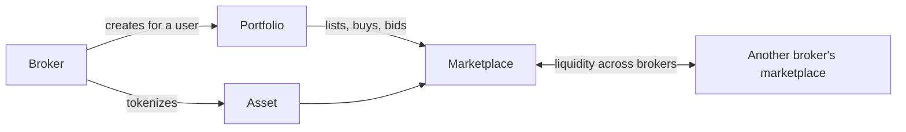

<p align="center">
  
</p>

<p align="center">
  
<a href="https://github.com/CoinClubQuincy/XDC-Defi-Instruments/actions/workflows/build.yml"></a>        
</p>

<p align="center">
  <a href="#what-is-included">What is included</a> · <a href="#how-it-fits-together">How it fits together</a> · <a href="#try-it">Try it</a> · <a href="#what-is-tested">What is tested</a> · <a href="#known-issues">Known issues</a>
</p>

This repository explores how tools that banks and broker-dealers run today could work as automated contracts on XDC: tokenized assets, signed agreements, forwards, futures, batches of assets, portfolios and a marketplace. A broker could run these with almost no infrastructure, and users could keep custody of their portfolios and move between brokers.

> [!WARNING]
> These are concept templates and have not been audited. Don't use them with real assets. Only part of the code is tested, and two files don't compile yet. See [What is tested](#what-is-tested).

## What is included

| Contract | Purpose | State |
| --- | --- | --- |
| [`Asset.sol`](contracts/Defi-Tools/Asset.sol) | Represents commodities, securities or currencies as tokens | Compiles |
| [`Contract.sol`](contracts/Defi-Tools/Contract.sol) | Two-party agreement tied to a document hash, with counter-proposals | Tested. Signing has a known issue |
| [`DocToken.sol`](contracts/Defi-Tools/DocToken.sol) | Registers documents as tokens | Compiles |
| [`Forward.sol`](contracts/Defi-Tools/Forward.sol) | Forward contract | Compiles |
| [`Future.sol`](contracts/Defi-Tools/Future.sol) | Futures contract | Compiles |
| [`MultiAssetBatch.sol`](contracts/Defi-Tools/MultiAssetBatch.sol) | Bundles assets into one token | Compiles |
| [`marketplace.sol`](contracts/Defi-Tools/marketplace.sol) | Listings, offers, auctions and escrow, forked from TronzitVeca's ERC1155-Marketplace, whose original repository is no longer online | Compiles |
| [`portfolio.sol`](contracts/Defi-Tools/portfolio.sol) | User portfolio that trades through marketplaces | Compiles |
| [`DelegatedExecutor.sol`](contracts/Defi-Tools/DelegatedExecutor.sol) | Sends funds on a user's behalf | Compiles |
| [`GeneralDeployer.sol`](contracts/Defi-Tools/GeneralDeployer.sol) | Deploys contracts from bytecode and keeps a list | Compiles |
| `Macro_Contracts.sol`, `Micro_Contracts.sol` | Early work on macro and micro parameters | **Doesn't compile yet** |

[`pyscripts/`](pyscripts) has Python helpers for working with these contracts, and [`Documents/`](Documents) has notes on individual contracts. The full article is in [docs/WRITEUP.md](docs/WRITEUP.md).

## How it fits together




<details>
<summary><strong>Diagrams of each instrument</strong></summary>

**Asset**


**Agreement**


**Multi-asset batch**


**Forward**


**Future**


</details>

## Try it

```bash
git clone https://github.com/CoinClubQuincy/XDC-Defi-Instruments.git
cd XDC-Defi-Instruments
git clone --depth 1 -b v4.9.6 https://github.com/OpenZeppelin/openzeppelin-contracts lib/openzeppelin-contracts
git clone --depth 1 -b v1.9.7 https://github.com/foundry-rs/forge-std lib/forge-std
forge test
```

You need [Foundry](https://getfoundry.sh). Tests named `test_KnownIssue_*` pass because they pin a defect, so a passing run does not mean the defect is gone.

## What is tested

[`test/foundry/Instruments.t.sol`](test/foundry/Instruments.t.sol) has 5 tests of `Contract.sol` and runs in CI on every push, along with a build of everything except the two unfinished files.

| Tested | Not tested |
| --- | --- |
| Hash verification and counter-proposals on `Contract.sol` | Behaviour of every other contract |
| Only the matching party being able to counter | A real network, testnet or mainnet |
| | An independent security audit |

The older Hardhat tests in `test/` don't run as pinned: `package.json` is missing `@openzeppelin/contracts`, and its `ethers` 5 conflicts with the Hardhat toolbox. With the dependency added, the suite ended at 0 passing and 17 failing on those setup errors, so it says nothing yet about the contracts.

## Known issues

| Issue | Effect | Test |
| --- | --- | --- |
| Nobody can sign an agreement | `sign_proposal()` requires both signatures to exist before anyone can sign | `test_KnownIssue_NobodyCanSignBecauseSigningRequiresBothSignatures` |
| `ContractDeployer` always reverts | The tokens are minted to the deployer contract, which can't receive them. Deploying `Contract` directly works | `test_KnownIssue_ContractDeployerAlwaysReverts` |
| Two files don't compile | `Macro_Contracts.sol` and `Micro_Contracts.sol` are excluded in `foundry.toml` | `forge build` |
| Licenses are mixed | Files declare GPL-3.0, MIT or UNLICENSED in their headers. Check each file before reuse | Read from the code |

<details>
<summary><strong>More XDC projects</strong></summary>

| Group | Project | What it is |
| --- | --- | --- |
| Standards | [XRC-SHARES](https://github.com/CoinClubQuincy/XRC-SHARES) | Dividend-paying NFT shares and SPLITS for a DApp |
| Standards | [XRCDividendPlus](https://github.com/CoinClubQuincy/XRCDividendPlus) | Dividend-paying XRC-20 token |
| Treasury and finance | [Multi-Sig-Treasury](https://github.com/CoinClubQuincy/Multi-Sig-Treasury) | Treasury controlled by tokenized keys |
| Treasury and finance | [XRC-Airdrop](https://github.com/CoinClubQuincy/XRC-Airdrop) | Self-run token airdrop |
| Treasury and finance | [XRC-Credit](https://github.com/CoinClubQuincy/XRC-Credit) | Debt contract skeleton |
| Identity and access | [LoginMFAContract](https://github.com/CoinClubQuincy/LoginMFAContract) | Login with a password and an NFT |
| Identity and access | [PrivateAccessToken](https://github.com/CoinClubQuincy/PrivateAccessToken) | Token-gated contract data demo |
| Identity and access | [Delegated_Authority](https://github.com/CoinClubQuincy/Delegated_Authority) | KYC notary proof of concept |
| Learning and libraries | [XDC-LemonadeStand](https://github.com/CoinClubQuincy/XDC-LemonadeStand) | Workshop DApp built on XRC-SHARES |
| Learning and libraries | [Non-Financial-SmartContracts](https://github.com/CoinClubQuincy/Non-Financial-SmartContracts) | Games, inventory, keys and on-chain repositories |
| Tools | [XDC_Python_SDK_V1](https://github.com/CoinClubQuincy/XDC_Python_SDK_V1) | Python client for the XDC JSON-RPC API |
| Tools | [PrivateXDCNode_SetupScript](https://github.com/CoinClubQuincy/PrivateXDCNode_SetupScript) | Private XDC network setup scripts |
| Tools | [WebApp_to_XDCPay](https://github.com/CoinClubQuincy/WebApp_to_XDCPay) | Web app to XDCPay tutorial |
| Multi-chain | [CoinClub_Framework](https://github.com/CoinClubQuincy/CoinClub_Framework) | Python library with an XDC adapter |
| Interfaces | [Contract_Interface_Model_Language](https://github.com/CoinClubQuincy/Contract_Interface_Model_Language) | Interface documents for smart contracts and APIs |

</details>

## License

Mixed. See the SPDX header of each file.
