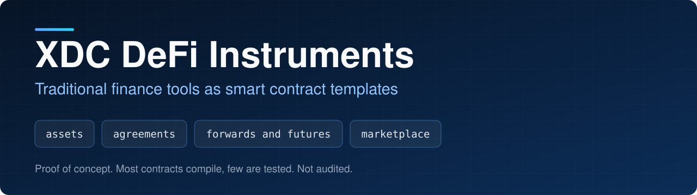
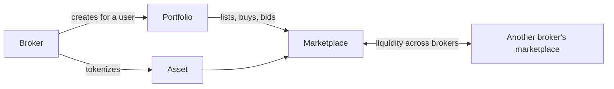

<p align="center">
  
</p>

<p align="center">
  
<a href="https://github.com/CoinClubQuincy/XDC-Defi-Instruments/actions/workflows/build.yml"></a>        
</p>

<p align="center">
  <a href="#what-is-included">What is included</a> · <a href="#how-it-fits-together">How it fits together</a> · <a href="#try-it">Try it</a> · <a href="#what-is-tested">What is tested</a> · <a href="#known-issues">Known issues</a>
</p>

This repository explores how tools that banks and broker-dealers run today could work as automated contracts on XDC: tokenized assets, signed agreements, forwards, futures, batches of assets, portfolios and a marketplace. A broker could run these with almost no infrastructure, and users could keep custody of their portfolios and move between brokers.

> [!WARNING]
> These are concept templates. They have not been audited and have not run on a real network. Don't use them with real assets. See [Known issues](#known-issues).

## What is included

| Contract | Purpose |
| --- | --- |
| [`Asset.sol`](contracts/Defi-Tools/Asset.sol) | Represents commodities, securities or currencies as tokens, run by a broker |
| [`Contract.sol`](contracts/Defi-Tools/Contract.sol) | Agreement tied to a document hash, signed by two parties and two witnesses, with counter-proposals |
| [`DocToken.sol`](contracts/Defi-Tools/DocToken.sol) | Registers documents as tokens |
| [`Forward.sol`](contracts/Defi-Tools/Forward.sol) | Forward contract: the buyer pays now and collects the asset after a set date |
| [`Future.sol`](contracts/Defi-Tools/Future.sol) | Futures contract: a deposit and fee now, the price later, and a default if nobody pays in time |
| [`MultiAssetBatch.sol`](contracts/Defi-Tools/MultiAssetBatch.sol) | Holds assets from several token contracts behind one set of keys |
| [`marketplace.sol`](contracts/Defi-Tools/marketplace.sol) | Listings, offers, auctions and escrow, forked from TronzitVeca's ERC1155-Marketplace, whose original repository is no longer online |
| [`portfolio.sol`](contracts/Defi-Tools/portfolio.sol) | User portfolio that holds tokens and trades through marketplaces, plus a ledger of accounts |
| [`DelegatedExecutor.sol`](contracts/Defi-Tools/DelegatedExecutor.sol) | Holds funds and sends them on a user's behalf, controlled by keys |
| [`GeneralDeployer.sol`](contracts/Defi-Tools/GeneralDeployer.sol) | Deploys contracts from bytecode and keeps a list |
| [`Macro_Contracts.sol`](contracts/Defi-Tools/Macro_Contracts.sol) | Keeps a versioned history of a data schema. Acting on it is left to other contracts |
| [`Micro_Contracts.sol`](contracts/Defi-Tools/Micro_Contracts.sol) | Holds rate parameters for other contracts to read |

[`pyscripts/`](pyscripts) has Python helpers for working with these contracts, and [`Documents/`](Documents) has notes on individual contracts. The full article is in [docs/WRITEUP.md](docs/WRITEUP.md).

## How it fits together




<details>
<summary><strong>Diagrams of each instrument</strong></summary>

**Asset**


**Agreement**


**Multi-asset batch**


**Forward**


**Future**


</details>

## Try it

```bash
git clone https://github.com/CoinClubQuincy/XDC-Defi-Instruments.git
cd XDC-Defi-Instruments
git clone --depth 1 -b v4.9.6 https://github.com/OpenZeppelin/openzeppelin-contracts lib/openzeppelin-contracts
git clone --depth 1 -b v1.9.7 https://github.com/foundry-rs/forge-std lib/forge-std
forge test
```

You need [Foundry](https://getfoundry.sh).

To try it on a network, use the Apothem testnet:

| Network | Chain ID | RPC |
| --- | --- | --- |
| Apothem testnet | 51 | `https://rpc.apothem.network` |
| XDC mainnet | 50 | `https://rpc.xinfin.network` |

```bash
forge create contracts/Defi-Tools/Asset.sol:Asset --rpc-url https://rpc.apothem.network --interactive --broadcast --legacy \
  --constructor-args "https://example.com/{id}.json"
```

### How money moves in the marketplace

Tokens stay with the seller until a sale, so the seller approves the marketplace on the token contract first. Sale money, replaced bids and fee shares wait in `escrowAmount`, and each person collects their own with `withdrawEscrow`. One bad recipient can't block a sale or an auction. Money behind an open offer is locked until the offer is accepted or cancelled.

## What is tested

[`test/foundry`](test/foundry) has 129 tests, including 3 fuzz tests, and runs in CI on every push.

| File | Tests | Covers |
| --- | --- | --- |
| [`Instruments.t.sol`](test/foundry/Instruments.t.sol) | 41 | `Contract`, `Asset`, `Document`, `DelegateExecutor`, `MACRO`, `MICRO` and `ManagerDeployer` |
| [`Derivatives.t.sol`](test/foundry/Derivatives.t.sol) | 35 | `Forward`, `Future` and `MultiAssetBatch`. Fuzz: money and tokens in equal money and tokens out |
| [`Marketplace.t.sol`](test/foundry/Marketplace.t.sol) | 53 | `Marketplace`, `Portfolio` and `portfolioLedger`. Fuzz: after each random action, the marketplace holds exactly what it owes |

Not tested: a real network, testnet or mainnet, an independent security audit, the Python helpers in `pyscripts/`, and whether the instruments meet any financial or securities rule.

## Changes from earlier versions

Contracts already deployed are unaffected and keep the old behaviour. Most of these contracts could not work before, or lost money when they did.

**Marketplace**

- `acceptOffer` paid the buyer instead of the seller. It now pays the seller.
- `claimAuction` could be repeated, paying out of other people's money. An auction now closes once, and the creator can close it too.
- Sales could be bought more than once and after their deadline. Sales now end when sold, and overpayment is refunded.
- Sale money, replaced bids and fee shares now go to `escrowAmount` instead of being sent straight away, so sellers and recipients call `withdrawEscrow`.
- Fee money with no recipient used to be stuck. It now goes to `feeReserve`, collected with `withdrawFeeReserve`. Fee settings have limits.
- Bids on auctions that don't exist used to take the money. They are now refused. If the tokens can't reach an auction winner, the winner's bid is refunded.
- Offers lock their money through the new `lockedEscrow`. `withdrawEscrow` can now take the full balance. New view `viewAuction`.
- An auction's `highestBid` starts at 0, and an increment can be bigger than the start price.

**Portfolio**

- `depositEscrow` withdrew instead of depositing. `makeOffer` and `placeBid` sent no money. A portfolio couldn't hold tokens or spend what it received. New functions `withdrawFunds` and `approveMarketplace`.
- `portfolioLedger` left the marketplace keys in a contract that couldn't use them. They now go to whoever deploys the ledger. `checkAccount` no longer creates accounts while looking them up, and `forwardFunds` works.
- `deleteMarketplace` only accepted marketplaces that were not saved. Saved marketplaces now keep their own names and numbers. `resetOwner` keeps working after the key moves.

**Instruments**

- `Contract`: signing works, with each role signing once. The fourth signature completes it, and a counter-proposal clears signatures. The constructor takes a `_holder`, which also makes `ContractDeployer` work.
- `DelegateExecutor`: `delegateCall` let anyone run outside code as this contract, so it is gone, replaced by a key-only `executeCall`. The password is gone too, because anything sent to a public chain is public. `SendXRC1155` works and token transfers are checked.
- `Forward`: terms can't change after listing, and a forward redeems once and can't be transferred. New `cancelListing` returns an unsold asset.
- `Future`: the constructor always reverted, the handler and future tokens shared an ID, and the handler could take the deposit at any time. It is rewritten around those rules, with new `cancelSale`, `inDefault`, `handlerBalance`, `listed` and `divisable`. The constructor takes one token address, and `AssetTokens` and `TokenList` are gone.
- `MultiAssetBatch`: adding and redeeming always reverted. Both work now, the limit is exact, and redeeming empties the batch.
- `Document`: the first document's token was also a handler key. They now have different IDs.
- `Asset`: `moveAsset` needed an approval it could never have. It no longer does.
- `Macro_Contracts.sol` and `Micro_Contracts.sol` now compile and work, with key-holder control.
- `Forward` and `Future` no longer define their own `ASSET` contract, which clashed in Hardhat. Contracts refuse money and tokens they could never return.

**Tooling**

- Removed the Hardhat setup (`hardhat.config.js`, `package.json`, `package-lock.json`, `scripts/`) and its tests, which could not run and no longer match, along with the `Lock` template. Foundry is the supported path.

The notes in [`Documents/`](Documents) and the article in [`docs/WRITEUP.md`](docs/WRITEUP.md) describe the original design, and some details have changed.

## Known issues

| Issue | Effect |
| --- | --- |
| Brokers have real power | An `Asset` handler can move or destroy anyone's asset. A marketplace key holder can reset a portfolio's owner. That is the design, so a broker must be trusted |
| Any one key is enough | Any `MultiAssetBatch` or `DelegateExecutor` key can take everything the contract holds, and `executeCall` can do anything |
| Marketplace sales rely on approvals | Tokens stay with the seller, so a seller can back out of an auction by moving them. The winner is refunded, but the sale doesn't happen |
| `Forward` and `Future` have one buyer | Each contract handles one sale. Deploy a new one for each deal |
| Buyers must check the token | `Forward` and `Future` accept any token contract the handler names. A fake token passes every check |
| Listing loops grow | `viewAllAssetsAndBids` reads every sale. It is meant for off-chain reads |
| Licenses are mixed | Files declare GPL-3.0, MIT or UNLICENSED in their headers. Check each file before reuse |

<details>
<summary><strong>More XDC and EVM projects</strong></summary>

| Group | Project | What it is |
| --- | --- | --- |
| Standards | [XRC-SHARES](https://github.com/CoinClubQuincy/XRC-SHARES) | Dividend-paying NFT shares and SPLITS for a DApp |
| Standards | [XRCDividendPlus](https://github.com/CoinClubQuincy/XRCDividendPlus) | Dividend-paying XRC-20 token |
| Treasury and finance | [Multi-Sig-Treasury](https://github.com/CoinClubQuincy/Multi-Sig-Treasury) | Treasury controlled by tokenized keys |
| Treasury and finance | [XRC-Airdrop](https://github.com/CoinClubQuincy/XRC-Airdrop) | Self-run token airdrop |
| Treasury and finance | [XRC-Credit](https://github.com/CoinClubQuincy/XRC-Credit) | Single-loan credit contract |
| Treasury and finance | [XRC1155-Equities-Market](https://github.com/CoinClubQuincy/XRC1155-Equities-Market) | Shares, portfolios and a marketplace on ERC-1155 |
| Treasury and finance | [NFTOTC](https://github.com/CoinClubQuincy/NFTOTC) | Over-the-counter sale of a token collection |
| Treasury and finance | [DAppProxySwap](https://github.com/CoinClubQuincy/DAppProxySwap) | Currency swaps for a DApp through a fixed router |
| Identity and access | [LoginMFAContract](https://github.com/CoinClubQuincy/LoginMFAContract) | Login with an NFT and a signed second factor |
| Identity and access | [PrivateAccessToken](https://github.com/CoinClubQuincy/PrivateAccessToken) | Token access to encrypted off-chain data |
| Identity and access | [Delegated_Authority](https://github.com/CoinClubQuincy/Delegated_Authority) | KYC notary proof of concept |
| Identity and access | [EncryptedNFT-Documents](https://github.com/CoinClubQuincy/EncryptedNFT-Documents) | NFTs tied to encrypted off-chain documents |
| Learning and libraries | [XDC-LemonadeStand](https://github.com/CoinClubQuincy/XDC-LemonadeStand) | Workshop DApp built on XRC-SHARES |
| Learning and libraries | [Non-Financial-SmartContracts](https://github.com/CoinClubQuincy/Non-Financial-SmartContracts) | Games, inventory, keys and on-chain repositories |
| Learning and libraries | [ContractLedger](https://github.com/CoinClubQuincy/ContractLedger) | On-chain list of contract addresses |
| Learning and libraries | [TimestampConverter](https://github.com/CoinClubQuincy/TimestampConverter) | Timestamps to calendar dates in Solidity |
| Tools | [XDC_Python_SDK_V1](https://github.com/CoinClubQuincy/XDC_Python_SDK_V1) | Python client for the XDC JSON-RPC API |
| Tools | [PrivateXDCNode_SetupScript](https://github.com/CoinClubQuincy/PrivateXDCNode_SetupScript) | Private XDC network setup scripts |
| Tools | [WebApp_to_XDCPay](https://github.com/CoinClubQuincy/WebApp_to_XDCPay) | Working web app connected to XDCPay |
| Multi-chain | [CoinClub_Framework](https://github.com/CoinClubQuincy/CoinClub_Framework) | Python library with an XDC adapter |
| Interfaces | [Contract_Interface_Model_Language](https://github.com/CoinClubQuincy/Contract_Interface_Model_Language) | Interface documents for smart contracts and APIs |

</details>

## License

Mixed. See the SPDX header of each file.
